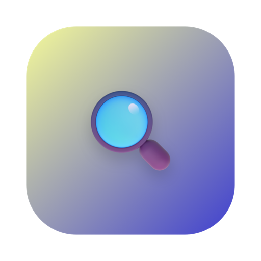
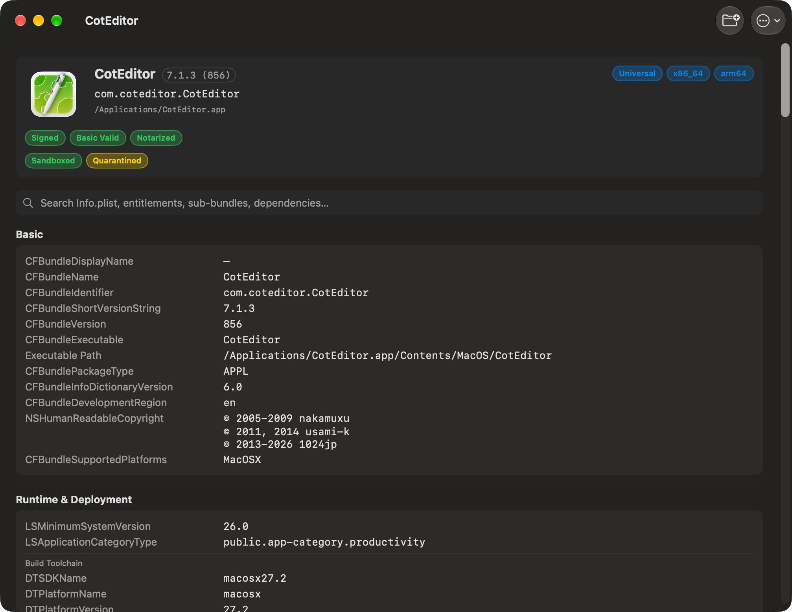

<p align="center">
  
</p>

<h1 align="center">SwiftLens</h1>

<p align="center">
  
  
  
  
  
  
</p>

> Vibe-coded with DeepSeek V4.1 Flash / OpenCode.

A native macOS app — built with Swift / SwiftUI / SPM — for inspecting `.app` bundles. Drop any `.app` onto the window and SwiftLens unpacks its identity, signature, quarantine state, architectures, entitlements, embedded sub-bundles, and dozens of other Info.plist fields in a single, scrollable report.

**SwiftLens itself runs inside the App Sandbox** — it never shells out to `codesign` / `spctl`, never asks for permission to read other apps' files, and never modifies anything on your disk. All signing data, notarization state, entitlements and quarantine flags are read through Apple's Security framework and `getxattr` only. A quarantine-removal **command is copied to your clipboard** so you can paste it into Terminal yourself — SwiftLens won't strip xattrs for you.

> 中文版说明请见 [README.zh-CN.md](./README.zh-CN.md).



## Features

- **Drag-and-drop or pick** any `.app` bundle — instant, single-window, no project list. Race-condition safe: a token tag prevents the older scan from overwriting the newer one when you drag in a second app before the first finishes.
- **Bilingual UI** — switches live between English and 简体中文 without an app relaunch (Follow system / 中文 / English); every GUI string and CLI line is localized.
- **Top header badges** — click any badge to jump straight to the related section: architectures / Agent-or-Background / iOS port / signature state / validity / notarization / sandbox / quarantine, plus a version badge next to the app name.
- **Basic identity** — `CFBundleIdentifier`, `CFBundleShortVersionString` / `CFBundleVersion`, `CFBundleExecutable`, package type, development region, `NSPrincipalClass`, copyright, version variants, supported platforms.
- **Runtime & deployment** — `LSMinimumSystemVersion` and `MinimumOSVersion` (iOS / Catalyst ports are not silently dropped; when both are missing, falls back to the main executable's `LC_BUILD_VERSION` / `LC_VERSION_MIN_*` minimum OS), `LSApplicationCategoryType`, high-resolution / graphics-switching / safe-area / sudden-termination switches, and the full build toolchain (`DTSDKName`, `DTPlatformVersion`, `DTXcode`, `BuildMachineOSBuild`, `DTCompiler`).
- **Architectures (Mach-O)** — parses fat / universal headers directly to list every slice (`arm64`, `arm64e` / `arm64e.x1` with PAC indicator, `x86_64`, `i386`, `ppc`…), with bit width, slice size, fat offset, declared `minos` and build SDK. Universal binaries split into independent `Universal · arm64 · x86_64` tags in the header.
- **Document types** — card list of `CFBundleDocumentTypes` (role badge, extensions, UTIs, handler rank, icon file) with an embedded scroll view when the list grows past 6 entries.
- **URL Schemes**, **Exported / Imported UTIs**, **NSServices**.
- **Privacy (TCC usage descriptions)** — every `NS***UsageDescription` key is mapped to a friendly title and SF Symbol, with a generic fallback for unknown keys.
- **Network security / Electron** — `NSAppTransportSecurity` exception domains, `ElectronAsarIntegrity` hashes.
- **Quarantine** — reads `com.apple.quarantine` via `getxattr`, decodes flags / agent / **download-event UUID** / hex timestamp into a date, and offers a **Copy remove command** button — the `xattr -d` line goes to your clipboard so you can run it in Terminal yourself (SwiftLens stays sandboxed and never mutates other apps).
- **Extended attributes** — full `listxattr` enumeration; binary values (e.g. `com.apple.macl`) shown as hex.
- **Code signing (no `codesign` / `spctl` subprocess)** — everything comes from `SecStaticCodeCheckValidity` and `SecCodeCopySigningInformation`. Reports both **basic validity** (`kSecCSBasicValidateOnly`) and **strict validity** (`kSecCSStrictValidate`, which additionally verifies sealed resources and nested code) with `kSecCSCheckAllArchitectures` across every fat slice, plus state, **notarization** (six levels: Notarized / Developer ID / Mac App Store / iOS App Store / Apple System / Not Notarized), `Format`, `Identifier`, `TeamIdentifier`, `CDHash` / `CandidateCDHashFull` (sha256-truncated, matching `codesign`), hash type / choices, signature size, decoded flags (`adhoc`, `runtime`, `library-validation`, `restrict`, `kill`, `linker-signed`…), `Runtime Version`, signing time, total / chosen signature, Info.plist entries, platform identifier, source, Authority chain, and a synthesized `codesign -dvvv`-style raw view. Two **Copy command** buttons drop `codesign -dvvv --strict --deep` and `spctl --assess -vvv` into the clipboard for manual verification in Terminal. A collapsible **Certificate Details** view shows each certificate's issuer, Not Before / Not After, SHA-256 fingerprint, and expired / expiring-soon badges. A **Consistency Checks** block compares Bundle ID vs signature Identifier, Info.plist TeamIdentifier vs signature TeamID, and shows Hardened Runtime / Library Validation status. **Apple System Signed** is certificate-based; a separate **System location** row shows whether the resolved path is on the read-only `/System` volume, so Apple-distributed apps outside `/System` are not mistaken for preinstalled ones.
- **Entitlements** — parsed key/value list plus the raw XML plist and a **Copy Entitlements XML** button; top row highlights `com.apple.security.app-sandbox`, and high-risk entitlements (disable-library-validation, allow-unsigned-executable-memory, DYLD env, get-task-allow, debugger, JIT, executable page protection, temporary exceptions) are flagged with warning icons and explanations.
- **Embedded sub-bundles** — scans `Frameworks/`, `EmbeddedFrameworks/`, `SharedFrameworks/`, `SystemFrameworks/`, `PlugIns/`, `XPCServices/`, `Helpers/`, `Extensions/`, `Library/LoginItems/`, `Library/SystemExtensions/`, `Library/LaunchServices/`, `Library/Spotlight/`, `Library/QuickLook/`, `Library/Automator/`, including framework-style `Versions/A/Resources/Info.plist` layouts. Each entry now reports BundleID / version / signature state / basic & strict validity / TeamID / architectures / Runtime Version, plus `NSExtensionPointIdentifier` / `NSExtensionPrincipalClass` and `XPCService` type / run loop. TeamID mismatches, invalid signatures, strict failures and architectures missing from the main app are flagged.
- **Mach-O dependencies** — parses `LC_LOAD_DYLIB` / `LC_LOAD_WEAK_DYLIB` / `LC_REEXPORT_DYLIB` / `LC_LOAD_UPWARD_DYLIB` / `LC_RPATH` across fat slices, resolves `@rpath` / `@executable_path` / `@loader_path`, treats `/usr/lib` and `/System/Library` as dyld shared-cache (not missing), and warns about unresolved dependencies or dependencies lacking the main app's architectures. Full list is expandable.
- **Privacy manifests & App Store receipt** — scans the main bundle, sub-bundles and iOS Wrapper for `PrivacyInfo.xcprivacy`, showing accessed API categories with reason codes, collected data types, tracking domains and `NSPrivacyTracking`; detects `Contents/_MASReceipt/receipt`.
- **Launch Agents / Daemons** — lists `Contents/Library/LaunchAgents` and `LaunchDaemons` plists with their `Label`.
- **Sparkle auto-update** — `SUFeedURL`, `SUPublicEDKey`, `SUPublicDSAKeyFile`, plus all `SUEnable*` / `SUScheduled*` switches (with seconds ↔ days conversion).
- **AppleScript / Siri / Intents** — `NSAppleScriptEnabled`, `OSAScriptingDefinition`, `NSUserActivityTypes`, `INIntentsSupported`, `SFSafariCorrespondingIOSAppBundleIdentifier`.
- **iCloud** — `NSUbiquitousContainers` expanded per container (each identifier serves as the section header so multi-container apps actually show the correct count).
- **Notifications** — `NSUserNotificationAlertStyle` and the three usage-description variants.
- **Misc switches** — sudden / automatic termination, `LSRequiresCarbon`, `LSRequiresNativeExecution`, `LSMultipleInstancesProhibited`, `LSFileQuarantineEnabled`, `GPUEjectPolicy` / `GPUSelectionPolicy`, `ITSAppUsesNonExemptEncryption`.
- **Help / localization / Accent / Spotlight** — `CFBundleHelpBookName` / `Folder`, `CFBundleLocalizations` merged with an actual `Contents/Resources/*.lproj` scan (most apps omit the plist key), `NSAccentColorName`, `MDItemKeywords`.
- **iOS port fields** — `UIDeviceFamily`, `UILaunchStoryboardName`, `UIRequiresFullScreen`, `UISupportedInterfaceOrientations`, `UIStatusBarStyle`, `UIBackgroundModes`, `ASWebAuthenticationSession…`. iOS-port apps with the `Wrapper/<name>.app/` layout are parsed correctly.
- **Electron / build metadata / vendor** — `ElectronTeamID`, `SourceVersion`, `requiredBuildHash`, `SCMRevision`, `AppIdentifierPrefix`, `CFBundleSpokenName`, `VendorCode`, `OrganizationIdentifier`, `CTFontSuppressAutoDownload`.
- **Bonjour** — `NSBonjourServices` shown verbatim (no over-eager `_…._tcp` re-wrapping).
- **File info** — recursive bundle size, modification / creation dates, octal permissions, App Store receipt, and a **Size Breakdown** by top-level `Contents` directory with percentages.
- **Info.plist health** — actual plist path, XML / Binary format, missing required keys, main executable presence and `_CodeSignature` resources, plus `LSMinimumSystemVersionByArchitecture`.
- **Raw `Info.plist`** (full flattened key/value dump) and **synthesized `codesign -dvvv` output** for debugging. Plist `Bool` values now render as `YES` / `NO` instead of `1` / `0`.
- **Search & export** — search bar with `⌘F` filters Info.plist keys, entitlements, sub-bundles, privacy manifests, dependencies and launch items; **Copy JSON** (also `--json` in CLI) and **Copy Entitlements XML**.
- **Recent apps** — `More ▸ Recent Apps` (second-level menu) keeps up to 10 apps with a live validity marker (valid / missing / invalid); click to reopen, remove a single entry, or clear all. Enabled by default in Settings and can be turned off; uses security-scoped bookmarks so read-only access survives relaunch.
- **Help sheet** — explains every header badge (notarization levels, sandbox, quarantine, validity, strict validity, agent / background / iOS port) and how to interpret them; open it from `More ▸ Help` or the menu `⌘?`.
- **Native Settings window** — standard macOS `Settings` scene with **General** / **Recent Apps** tabs: language (Follow system / 中文 / English), theme, and recent-apps recording (on by default), persisted via `@AppStorage`.
- **Standard About panel** — macOS About panel with app icon, version / build, copyright, and clickable Repository / License links.
- **Hidden CLI mode** — `swift run SwiftLens /path/to.app` prints a full localized plain-text summary and exits; `--json` outputs a structured JSON report. Useful for scripting.

## Sandbox notes

SwiftLens ships with these entitlements:

```xml
com.apple.security.app-sandbox = true
com.apple.security.files.user-selected.read-only = true
com.apple.security.files.bookmarks.app-scope = true
```

That means:

- It cannot spawn `codesign`, `spctl`, `xattr`, `spctl` or any other subprocess.
- It can read whatever file the user drops in via the open panel / drag-and-drop (`SecStaticCodeCheckValidity`, `getxattr`, `listxattr` all work under the sandbox), but it cannot mutate other apps' bundles.
- Recent apps use **security-scoped bookmarks** (read-only) so they can be reopened after a relaunch; this is still the standard App Sandbox model and does not grant write access.
- Removing `com.apple.quarantine` is therefore exposed as a **Copy command** button, not a destructive action.

## Requirements

- macOS 15.0+
- Xcode 27.x (for the bundled Xcode project) or just the Swift 6.0+ toolchain (for SPM)

## Build & run

### SPM (no Xcode UI needed)

```sh
swift run SwiftLens                          # launches the GUI
swift run SwiftLens /Applications/Safari.app # CLI summary mode
```

### Xcode project (coexists with SPM)

The repository includes `SwiftLens.xcodeproj`, generated with [xcodegen](https://github.com/yonaskolb/Xcodegen) from `project.yml`. To regenerate after adding or removing source files:

```sh
xcodegen generate
open SwiftLens.xcodeproj
```

Both build paths compile the same sources under `Sources/SwiftLens/`.

## Project layout

```
SwiftLens/
├─ Package.swift                       # SPM manifest
├─ project.yml                         # xcodegen config (Xcode project source of truth)
├─ SwiftLens.xcodeproj/                # generated Xcode project (kept in git)
├─ SwiftLens/
│  ├─ Info.plist
│  ├─ SwiftLens.entitlements           # app-sandbox + read-only user file access + bookmarks
│  └─ Assets.xcassets/
│     └─ AppIcon.appiconset/
└─ Sources/SwiftLens/
   ├─ SwiftLensApp.swift               # @main App + AppDelegate (CLI mode + Dock focus fix)
   ├─ AppState.swift                   # language / theme / recent apps persistence
   ├─ L10n.swift                       # runtime zh/en string table (live switch)
   ├─ SettingsView.swift               # native Settings window (General / Recent Apps)
   ├─ AppMeta.swift                    # app metadata + standard About panel
   ├─ HelpView.swift                   # help sheet (badge legend)
   ├─ ContentView.swift                # drag-and-drop shell + loading overlay (race-safe)
   ├─ DetailView.swift                 # all info sections + header badges + Badge view
   ├─ SharedViews.swift                # RowView / SectionView / PlaceholderRow
   ├─ AppInfo.swift                    # aggregated model + loader
   ├─ InfoPlistParser.swift            # Info.plist parse + flatten (CFBoolean-aware)
   ├─ QuarantineReader.swift           # com.apple.quarantine read (incl. UUID)
   ├─ ExtendedXattrReader.swift        # full xattr enumeration
   ├─ ArchitectureReader.swift         # Mach-O / fat header parse (arm64e / PAC aware)
   ├─ MachODependencyReader.swift      # LC_LOAD_DYLIB / LC_RPATH + @rpath resolution
   ├─ CodeSignReader.swift             # Security-framework-only: SecStaticCodeCheckValidity
   │                                    #   (kSecCSStrictValidate | kSecCSCheckAllArchitectures)
   │                                    #   + SecCodeCopySigningInformation
   ├─ SubBundleScanner.swift           # Frameworks / SharedFrameworks / Helpers / XPC /
   │                                    #   PlugIns / Extensions / Library scans
   ├─ PrivacyReader.swift              # TCC usage-description catalog
   ├─ PrivacyManifestReader.swift      # PrivacyInfo.xcprivacy + MAS receipt
   └─ ExtraInfoReader.swift            # Sparkle / AppleScript / iCloud / Bonjour / ...
```

## License

MIT — see `LICENSE`. Source code is provided as-is.

## Acknowledgements

Inspired by Bilibili creator [小调mac实验室](https://space.bilibili.com/3632303882373576).

---

中文版说明：[README.zh-CN.md](./README.zh-CN.md)
