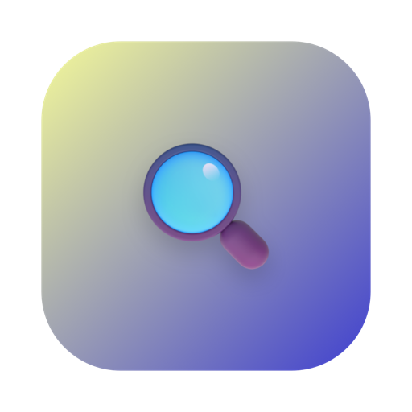
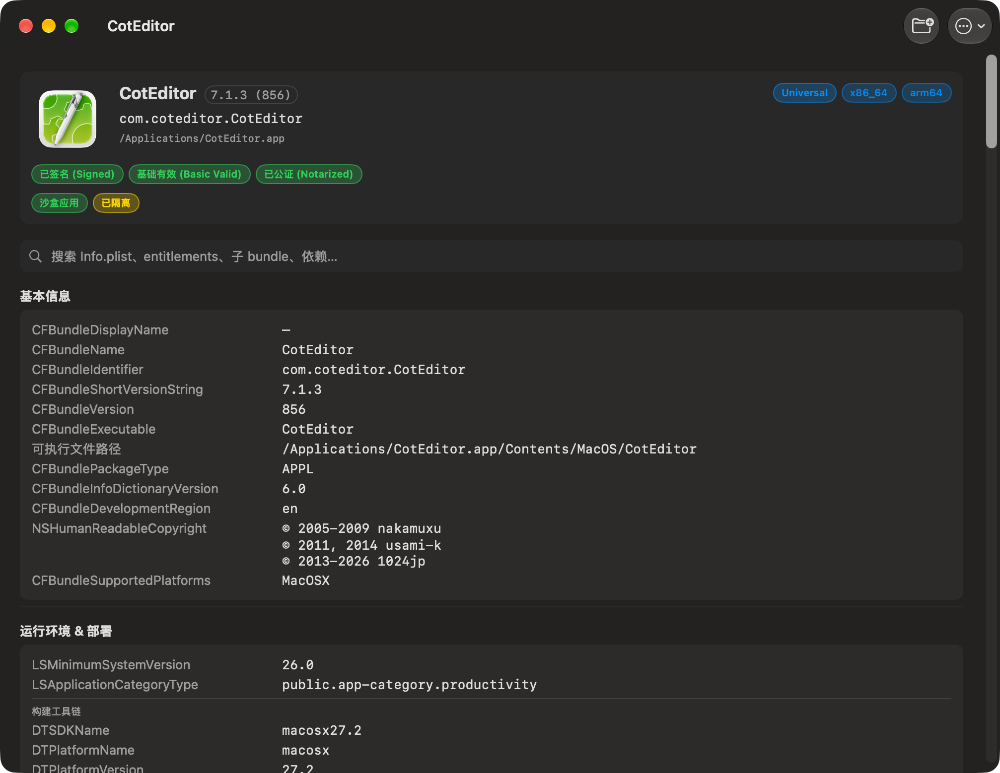

<p align="center">
  
</p>

<h1 align="center">SwiftLens</h1>

<p align="center">
  
  
  
  
  
</p>

> Vibe Coding而成（DeepSeek V4.1 Flash / OpenCode）

一个用 Swift / SwiftUI / SPM 编写的原生 macOS `.app` 信息查看器。把任意 `.app` 拖到窗口里，SwiftLens 会在一个可滚动的报告中一次性展开它的身份、签名、隔离状态、架构、entitlements、内嵌子 bundle 以及数十个其它 Info.plist 字段。

**SwiftLens 自身运行在 App Sandbox 沙盒中** —— 它从不调用 `codesign` / `spctl` 等子进程，从不申请读取其它 app 文件的权限，也从不修改磁盘上的任何东西。所有签名数据、公证状态、entitlements 与隔离标记都只通过 Apple 的 Security framework 与 `getxattr` 读取。隔离属性的「移除」以 **复制命令到剪贴板** 形式提供 —— 你需要自己在终端粘贴运行；SwiftLens 不会替你清掉他人 app 的 xattr。

> English version: [README.md](./README.md).



## 功能

- **拖入或选择**任意 `.app` bundle —— 单窗口即用即走，无列表。带竞态保护：拖入第二个 app 时若前一个还没扫完，旧结果不会覆盖新的。
- **中英双语界面** —— 实时切换 English / 简体中文（跟随系统 / 中文 / English），无需重启；GUI 与 CLI 摘要全部本地化。
- **顶部 header 徽章** —— 点击任意徽章跳转到对应分区：架构 / Agent-or-Background / iOS 移植 / 签名状态 / 有效性 / 公证 / 沙盒 / 隔离；应用名旁还带版本徽章。
- **基本身份** —— `CFBundleIdentifier`、`CFBundleShortVersionString` / `CFBundleVersion`、`CFBundleExecutable`、PackageType、开发语言、`NSPrincipalClass`、版权、版本变体、支持平台。
- **运行环境 & 部署** —— `LSMinimumSystemVersion` **及** `MinimumOSVersion`（iOS / Catalyst 移植包不再漏读；两者都缺失时回退到主可执行文件的 `LC_BUILD_VERSION` / `LC_VERSION_MIN_*` 最低系统版本）、`LSApplicationCategoryType`、高分辨率 / 图形切换 / 安全区 / 突然终止等开关，以及完整构建工具链（`DTSDKName`、`DTPlatformVersion`、`DTXcode`、`BuildMachineOSBuild`、`DTCompiler`）。
- **架构 (Mach-O)** —— 直接解析 fat / universal 头，列出每个切片（`arm64`、`arm64e` / `arm64e.x1` 标注 PAC、`x86_64`、`i386`、`ppc`…），含位数、切片大小、fat 偏移、切片声明的 `minos` 与构建 SDK。通用二进制在 header 拆成独立的 `Universal · arm64 · x86_64` tag。
- **文档类型** —— `CFBundleDocumentTypes` 卡片列表（角色 badge、扩展名、UTIs、handler rank、图标文件），超过 6 项时启用内嵌滚动。
- **URL Schemes**、**Exported / Imported UTIs**、**NSServices**。
- **隐私权限描述 (TCC)** —— 所有 `NS***UsageDescription` 键映射到友好标题 + SF Symbol，未知键有兜底解析。
- **网络安全 / Electron** —— `NSAppTransportSecurity` 例外域、`ElectronAsarIntegrity` 哈希。
- **Quarantine 隔离** —— 通过 `getxattr` 读取 `com.apple.quarantine`，解码 flags / agent / **下载事件 UUID** / 十六进制时间戳为日期，并提供 **复制移除命令** 按钮 —— `xattr -d com.apple.quarantine ...` 写入剪贴板，自己在终端粘贴运行（应用保持沙盒，不动他 app）。
- **扩展属性全列表** —— `listxattr` 枚举所有 xattrs；二进制值（如 `com.apple.macl`）以十六进制展示。
- **代码签名（无 `codesign` / `spctl` 子进程）** —— 全部来自 `SecStaticCodeCheckValidity` 与 `SecCodeCopySigningInformation`。同时报告 **基础验证**（`kSecCSBasicValidateOnly`）与 **严格验证**（`kSecCSStrictValidate`，额外校验资源封印与嵌套代码），均附加 `kSecCSCheckAllArchitectures` 覆盖所有 fat 切片；并列出状态、**公证**（6 级：已公证 / Developer ID / Mac App Store / iOS App Store / Apple 系统签名 / 未公证）、`Format`、`Identifier`、`TeamIdentifier`、`CDHash` / `CandidateCDHashFull`（sha256 截断，与 `codesign` 一致）、哈希类型 / choices、签名大小、解码后的 flags（`adhoc`、`runtime`、`library-validation`、`restrict`、`kill`、`linker-signed`…）、`Runtime Version`、签名时间、total / chosen signature、Info.plist entries、平台标识、source、Authority 链，并合成 `codesign -dvvv` 风格的原始视图。两个 **复制命令** 按钮把 `codesign -dvvv --strict --deep` 和 `spctl --assess -vvv` 写入剪贴板，方便在终端手动验证。可展开的 **证书详情** 展示每张证书的签发者、有效期、SHA-256 指纹，以及过期 / 即将过期徽章。**一致性检查** 比对 Bundle ID 与签名 Identifier、Info.plist TeamIdentifier 与签名 TeamID，并显示 Hardened Runtime / Library Validation 状态。**Apple 系统签名** 基于证书链判定；文件信息中的 **系统位置** 显示解析后的路径是否位于只读 `/System` 卷，因此 Apple 分发但不在 `/System` 的应用不会被误认为预装。
- **Entitlements** —— 解析后的键值列表 + 原始 XML plist，并提供 **复制 Entitlements XML** 按钮；顶部一行高亮 `com.apple.security.app-sandbox`，高风险 entitlement（disable-library-validation、allow-unsigned-executable-memory、DYLD 环境变量、get-task-allow、debugger、JIT、关闭可执行页保护、temporary-exception）会显示警告图标与说明。
- **内嵌子 bundle** —— 扫描 `Frameworks/`、`EmbeddedFrameworks/`、`SharedFrameworks/`、`SystemFrameworks/`、`PlugIns/`、`XPCServices/`、`Helpers/`、`Extensions/`、`Library/LoginItems/`、`Library/SystemExtensions/`、`Library/LaunchServices/`、`Library/Spotlight/`、`Library/QuickLook/`、`Library/Automator/`，支持 framework 的 `Versions/A/Resources/Info.plist` 布局。每个条目报告 BundleID / 版本 / 签名状态 / 基础与严格验证 / TeamID / 架构 / Runtime Version，并展示 `NSExtensionPointIdentifier` / `NSExtensionPrincipalClass` 与 `XPCService` 类型 / run loop。TeamID 不一致、签名无效、严格验证失败、架构少于主应用时显示警告。
- **Mach-O 依赖** —— 解析 fat 切片中的 `LC_LOAD_DYLIB` / `LC_LOAD_WEAK_DYLIB` / `LC_REEXPORT_DYLIB` / `LC_LOAD_UPWARD_DYLIB` / `LC_RPATH`，解析 `@rpath` / `@executable_path` / `@loader_path`；`/usr/lib` 与 `/System/Library` 视为 dyld 共享缓存不算缺失；缺失依赖或缺少主应用架构时告警，完整列表可展开。
- **隐私清单与 App Store 收据** —— 扫描主包、子 bundle 与 iOS Wrapper 中的 `PrivacyInfo.xcprivacy`，展示访问的 API 类别与原因码、收集的数据类型、跟踪域名与 `NSPrivacyTracking`；检测 `Contents/_MASReceipt/receipt`。
- **启动项** —— 列出 `Contents/Library/LaunchAgents` 与 `LaunchDaemons` 中的 plist 及其 `Label`。
- **Sparkle 自动更新** —— `SUFeedURL`、`SUPublicEDKey`、`SUPublicDSAKeyFile`，以及所有 `SUEnable*` / `SUScheduled*` 开关（秒 ↔ 天自动换算）。
- **AppleScript / Siri / Intents** —— `NSAppleScriptEnabled`、`OSAScriptingDefinition`、`NSUserActivityTypes`、`INIntentsSupported`、`SFSafariCorrespondingIOSAppBundleIdentifier`。
- **iCloud** —— `NSUbiquitousContainers` 按容器完整展开（每个容器 ID 作为小节标题，多容器应用不再被合并成 1 项）。
- **通知** —— `NSUserNotificationAlertStyle` 与三种 UsageDescription。
- **杂项开关** —— 突然 / 自动终止、`LSRequiresCarbon`、`LSRequiresNativeExecution`、`LSMultipleInstancesProhibited`、`LSFileQuarantineEnabled`、`GPUEjectPolicy` / `GPUSelectionPolicy`、`ITSAppUsesNonExemptEncryption`。
- **帮助 / 本地化 / Accent / Spotlight** —— `CFBundleHelpBookName` / `Folder`、`CFBundleLocalizations` 并与实际 `Contents/Resources/*.lproj` 目录扫描合并（多数应用不写该 plist 键）、`NSAccentColorName`、`MDItemKeywords`。
- **iOS 移植包字段** —— `UIDeviceFamily`、`UILaunchStoryboardName`、`UIRequiresFullScreen`、`UISupportedInterfaceOrientations`、`UIStatusBarStyle`、`UIBackgroundModes`、`ASWebAuthenticationSession…`。`Wrapper/<name>.app/` 布局的 iOS 移植包能正确解析。
- **Electron / 构建元数据 / 厂商** —— `ElectronTeamID`、`SourceVersion`、`requiredBuildHash`、`SCMRevision`、`AppIdentifierPrefix`、`CFBundleSpokenName`、`VendorCode`、`OrganizationIdentifier`、`CTFontSuppressAutoDownload`。
- **Bonjour** —— `NSBonjourServices` 原样显示，不再追加 `_…._tcp` 后缀造成重复拼接。
- **文件信息** —— 递归 bundle 体积、修改 / 创建时间、八进制权限、App Store 收据，以及按 `Contents` 一级目录统计的 **体积构成** 与占比。
- **Info.plist 健康检查** —— 实际 plist 路径、XML / Binary 格式、缺失必需键、主可执行文件与 `_CodeSignature` 资源检查，并展示 `LSMinimumSystemVersionByArchitecture`。
- **原始 `Info.plist`**（扁平化全键值）与 **合成的 `codesign -dvvv` 输出**，便于调试。plist 中 `Bool` 值正确显示为 `YES` / `NO`，而不再是 `1` / `0`。
- **搜索与导出** —— 搜索框（`⌘F`）可过滤 Info.plist 键值、entitlements、子 bundle、隐私清单、依赖与启动项；支持 **复制 JSON**（CLI 亦可 `--json`）与 **复制 Entitlements XML**。
- **最近打开** —— `更多 ▸ 最近打开`（二级菜单）保留最近 10 个 app，并实时标记有效性（有效 / 已失效 / 无效）；点击重新打开，支持移除单项与清空全部。设置中默认开启、可关闭；使用安全作用域书签，重启后仍可只读访问。
- **帮助 sheet** —— 解释 header 上的每一个徽章（公证 6 级、沙盒、隔离、签名有效性、Agent / Background / iOS 移植），告诉你如何解读它们；通过工具栏 `?` 按钮、菜单 `⌘?` 或窗口通知打开。
- **原生设置窗口** —— 使用 macOS 标准 `Settings` scene，**通用** / **最近打开** 两个标签页：语言（跟随系统 / 中文 / English）、主题、最近打开记录（默认开启），通过 `@AppStorage` 持久化。
- **标准关于面板** —— 系统 About 面板，包含应用图标、版本 / 构建号、版权，以及可点击的仓库 / 许可证链接。
- **隐藏 CLI 模式** —— `swift run SwiftLens /path/to.app` 打印完整本地化纯文本摘要并退出；`--json` 输出结构化 JSON，便于脚本化。

## 沙盒说明

SwiftLens 自带如下 entitlements：

```xml
com.apple.security.app-sandbox = true
com.apple.security.files.user-selected.read-only = true
com.apple.security.files.bookmarks.app-scope = true
```

这意味着：

- 不会调用 `codesign`、`spctl`、`xattr` 等任何子进程。
- 通过用户从打开面板 / 拖拽进来的 app 文件，可以读取（`SecStaticCodeCheckValidity`、`getxattr`、`listxattr` 在沙盒下都能用），但不能修改其它 app 的 bundle。
- 「最近打开」使用 **security-scoped bookmark**（只读）以便重启后重新打开；仍属于标准 App Sandbox 模型，不会获得写权限。
- 因此「移除隔离」只能以 **复制命令** 按钮方式提供，不能直接代为执行 `xattr -d`。

## 环境要求

- macOS 15.0+
- Xcode 26.x（用于附带的 Xcode 项目），或仅需 Swift 6.0+ 工具链（用于 SPM）

## 构建与运行

### SPM（无需打开 Xcode）

```sh
swift run SwiftLens                            # 启动 GUI
swift run SwiftLens /Applications/Safari.app   # CLI 摘要模式
```

### Xcode 项目（与 SPM 共存）

仓库包含 `SwiftLens.xcodeproj`，由 [xcodegen](https://github.com/yonaskolb/Xcodegen) 从 `project.yml` 生成。新增 / 移除源文件后重新生成：

```sh
xcodegen generate
open SwiftLens.xcodeproj
```

两种构建路径都编译同一份 `Sources/SwiftLens/` 源码。

## 项目结构

```
SwiftLens/
├─ Package.swift                       # SPM 清单
├─ project.yml                         # xcodegen 配置 (Xcode 项目的真相来源)
├─ SwiftLens.xcodeproj/                # 生成的 Xcode 项目 (入库)
├─ SwiftLens/
│  ├─ Info.plist
│  ├─ SwiftLens.entitlements           # app-sandbox + 只读用户文件访问 + bookmarks
│  └─ Assets.xcassets/
│     └─ AppIcon.appiconset/
└─ Sources/SwiftLens/
   ├─ SwiftLensApp.swift               # @main App + AppDelegate (CLI 模式 + Dock 焦点修复)
   ├─ AppState.swift                   # 语言 / 主题 / 最近打开持久化
   ├─ L10n.swift                       # 运行时 zh/en 字符串表 (实时切换)
   ├─ SettingsView.swift               # 原生设置窗口 (通用 / 最近打开)
   ├─ AppMeta.swift                    # 应用元数据 + 标准 About 面板
   ├─ HelpView.swift                   # 帮助 sheet (徽章说明)
   ├─ ContentView.swift                # 拖放壳 + 加载遮罩 (带竞态保护)
   ├─ DetailView.swift                 # 所有信息分区 + header 徽章 + Badge view
   ├─ SharedViews.swift                # RowView / SectionView / PlaceholderRow
   ├─ AppInfo.swift                    # 聚合模型 + loader
   ├─ InfoPlistParser.swift            # Info.plist 解析 + 扁平化 (区分 CFBoolean)
   ├─ QuarantineReader.swift           # com.apple.quarantine 读取 (含 UUID)
   ├─ ExtendedXattrReader.swift        # 全 xattr 枚举
   ├─ ArchitectureReader.swift         # Mach-O / fat 头解析 (识别 arm64e / PAC)
   ├─ MachODependencyReader.swift      # LC_LOAD_DYLIB / LC_RPATH + @rpath 解析
   ├─ CodeSignReader.swift             # 仅用 Security framework:
   │                                    #   SecStaticCodeCheckValidity
   │                                    #   (kSecCSStrictValidate | kSecCSCheckAllArchitectures)
   │                                    #   + SecCodeCopySigningInformation
   ├─ SubBundleScanner.swift           # Frameworks / SharedFrameworks / Helpers / XPC /
   │                                    #   PlugIns / Extensions / Library 扫描
   ├─ PrivacyReader.swift              # TCC 权限描述目录
   ├─ PrivacyManifestReader.swift      # PrivacyInfo.xcprivacy + MAS 收据
   └─ ExtraInfoReader.swift            # Sparkle / AppleScript / iCloud / Bonjour / ...
```

## 许可

MIT —— 如存在 `LICENSE` 文件则以其为准。源码按 "as-is" 提供。

## 鸣谢

灵感来自 Bilibili Up 主 [小调mac实验室](https://space.bilibili.com/3632303882373576)。

---

English version: [README.md](./README.md)
